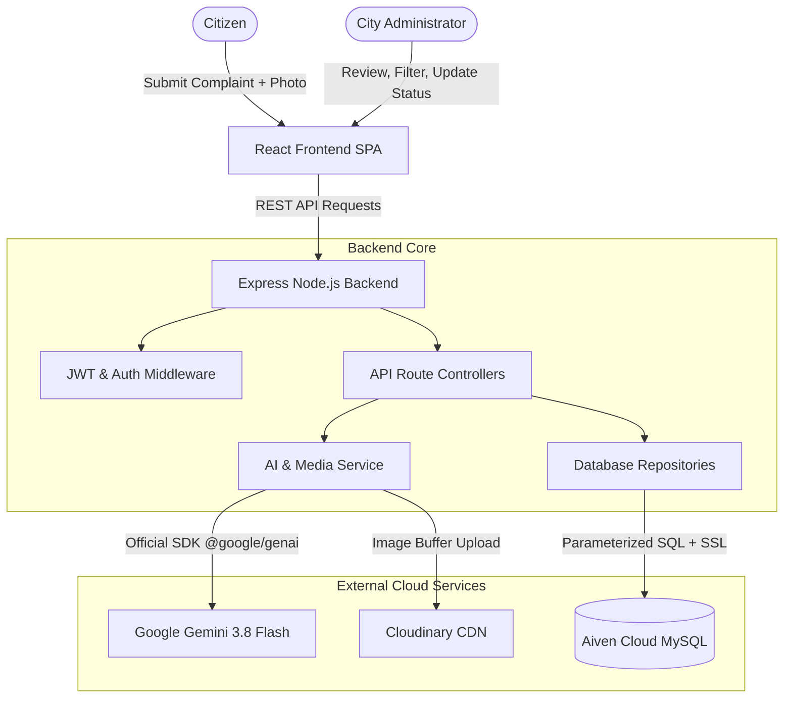

# CivicLens System Architecture

CivicLens is an AI-powered civic infrastructure complaint management platform designed for citizens and municipal administrators.

## 1. Module Ownership Matrix

| Agent | Scope Directory | Primary Responsibilities |
|---|---|---|
| **@frontend** | `frontend/**` | React 18 + Vite SPA, Lucide React, Citizen reporting form, AI assessment preview, tracking UI, Admin dashboard, Public Transparency dashboard. |
| **@backend** | `backend/src/routes/**`, `backend/src/controllers/**`, `backend/src/middleware/**`, `backend/src/server.js`, `backend/src/app.js`, `backend/src/services/auth/**` | Express app, routing, JWT auth, input validation (Zod), rate limiting, error handling, CORS, complaint workflow orchestration. |
| **@database** | `backend/database/**`, `backend/src/config/database.js`, `backend/src/repositories/**` | Aiven Cloud MySQL connection pooling, SSL, migrations, seed script, parameterized repositories for complaints, admin, and status history. |
| **@ai-media** | `backend/src/services/ai/**`, `backend/src/services/storage/**` | Google Gemini Vision API analysis (@google/genai), structured JSON output, Cloudinary secure image buffer uploads, graceful fallback when credentials are missing. |
| **@verifier** | `tests/**`, `docs/verification-report.md` | Integration testing, API contract tests, DB persistence verification, security audits, frontend responsiveness checks. |
| **Lead Orchestrator** | Root files, `.gitignore`, `.env.example`, `README.md`, `DEPLOYMENT.md`, `docs/**` | Architecture, shared technical contract, dependency harmonization, build verification, deployment readiness. |

---

## 2. Shared Data Models

### Complaint Record (`complaints`)
- `id` (INT AUTO_INCREMENT PRIMARY KEY)
- `complaint_code` (VARCHAR(16) UNIQUE NOT NULL) - e.g. `CL-2025-XXXX`
- `title` (VARCHAR(255) NOT NULL)
- `description` (TEXT NOT NULL)
- `locality` (VARCHAR(255) NOT NULL)
- `landmark` (VARCHAR(255) NULL)
- `citizen_name` (VARCHAR(150) NULL)
- `citizen_phone` (VARCHAR(30) NULL)
- `citizen_email` (VARCHAR(150) NULL)
- `image_url` (VARCHAR(500) NULL) - Cloudinary secure URL
- `image_public_id` (VARCHAR(255) NULL)
- `issue_type` (VARCHAR(100) NOT NULL)
- `severity` (ENUM('Low', 'Medium', 'High', 'Critical') DEFAULT 'Medium')
- `department` (VARCHAR(100) NOT NULL)
- `ai_summary` (TEXT NULL)
- `ai_risk_reason` (TEXT NULL)
- `ai_recommended_action` (TEXT NULL)
- `ai_confidence` (ENUM('Low', 'Medium', 'High') DEFAULT 'Medium')
- `needs_human_review` (BOOLEAN DEFAULT TRUE)
- `status` (ENUM('SUBMITTED', 'IN_REVIEW', 'ACTION_SCHEDULED', 'IN_PROGRESS', 'RESOLVED', 'REJECTED') DEFAULT 'SUBMITTED')
- `admin_notes` (TEXT NULL)
- `created_at` (TIMESTAMP DEFAULT CURRENT_TIMESTAMP)
- `updated_at` (TIMESTAMP DEFAULT CURRENT_TIMESTAMP ON UPDATE CURRENT_TIMESTAMP)

### Admin User (`admins`)
- `id` (INT AUTO_INCREMENT PRIMARY KEY)
- `email` (VARCHAR(150) UNIQUE NOT NULL)
- `password_hash` (VARCHAR(255) NOT NULL)
- `full_name` (VARCHAR(150) NOT NULL)
- `role` (VARCHAR(50) DEFAULT 'admin')
- `created_at` (TIMESTAMP DEFAULT CURRENT_TIMESTAMP)

### Status History (`complaint_status_history`)
- `id` (INT AUTO_INCREMENT PRIMARY KEY)
- `complaint_id` (INT NOT NULL, FOREIGN KEY -> complaints(id) ON DELETE CASCADE)
- `from_status` (VARCHAR(50) NULL)
- `to_status` (VARCHAR(50) NOT NULL)
- `changed_by` (VARCHAR(150) NOT NULL)
- `change_reason` (TEXT NULL)
- `created_at` (TIMESTAMP DEFAULT CURRENT_TIMESTAMP)

---

## 3. Resilience and Graceful Fallbacks

1. **AI Service Fallback**: If `GEMINI_API_KEY` is not provided or Gemini returns an error/timeout, the complaint submission **must not fail**. The backend/AI service will populate default safe classification metadata (`needsHumanReview: true`, `confidence: "Low"`, fallback issue type based on citizen input) and log a warning.
2. **Storage Fallback**: If Cloudinary credentials are not configured, an internal temporary file handler or safe data URI fallback should be supported in development, but in production Cloudinary uploads are standard.
3. **Database Transactions**: Status updates must record a row in `complaint_status_history` atomically using a database transaction.
